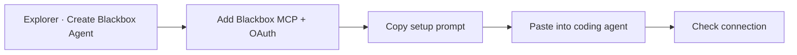

# Quick start

Create a Blackbox Agent in Softprobe Explorer, connect Blackbox MCP in your coding agent, apply the setup prompt or point an existing OpenTelemetry exporter at Blackbox, and verify your first captured Session.

## Flow



## 1. Create a Blackbox Agent

In Softprobe Explorer, open **Agents** and click **+ Connect agent**. Name the Agent, select the environment, and choose the app integration (**Traditional web app**, **LangChain**, **Vercel AI**, or **OpenCode**).

Softprobe issues an **Ingestion Key** (`spk_...`) for telemetry ingestion. It can send OTLP telemetry to `https://explorer.softprobe.ai/api/thelake/v1/traces`. It cannot read Sessions or manage Agents.

## 2. Add Blackbox MCP and sign in

Add `https://explorer.softprobe.ai/mcp` as `blackbox` in Claude Code, Codex, Cursor, OpenCode, or Antigravity (`agy`) using the commands shown in Explorer, then complete the Explorer OAuth sign-in flow. Your coding agent uses this OAuth connection to call `list_workspaces`, `search_sessions`, and `get_session_spans`.

See [Investigate with a coding agent](/en/agent-qa/coding-agent-skills) for client setup commands.

## 3. Configure telemetry capture

Copy the generated Blackbox setup prompt from the Agent's **Actions** menu with **Copy Blackbox setup prompt**, or from the **Connect Blackbox Agent** page. Paste it into your application repository in your coding agent. The prompt includes your Ingestion Key, `@softprobe/web-record` browser configuration, official OpenTelemetry OBI v1.0.0 (`obi.yaml`) backend configuration, and AI framework setup with distinct OpenTelemetry `service.name` values per tier:

| App integration | What the setup prompt configures |
|-----------------|----------------------------------|
| **Traditional web app** | `@softprobe/web-record` (`serviceName` for the browser) and official OpenTelemetry OBI v1.0.0 (`OTEL_SERVICE_NAME` on each backend) |
| **LangChain** | Browser and OBI capture plus `softprobe[langchain]` in Python or `@softprobe/langchain` in TypeScript |
| **Vercel AI** | Browser and OBI capture plus `@softprobe/vercel-ai-sdk` and `@softprobe/tracing` (`serviceName` for the AI server) |
| **OpenCode** | Browser and OBI capture plus `@softprobe/opencode-plugin` |
| **OpenTelemetry GenAI, OpenInference, or OpenLLMetry** | Standard OTLP HTTP trace export to Blackbox with `OTEL_SERVICE_NAME` and no custom Softprobe attributes |

### Direct OTLP export for existing OpenTelemetry apps

If your service already emits OpenTelemetry GenAI (`gen_ai.*`), Arize OpenInference (`openinference.*`), or Traceloop OpenLLMetry (`traceloop.*`) spans, point its standard OTLP HTTP trace exporter directly at Blackbox without adding custom span attributes:

```sh
export OTEL_SERVICE_NAME="my-agent"
export INGESTION_KEY="spk_REPLACE_WITH_INGESTION_KEY"
export OTEL_EXPORTER_OTLP_TRACES_ENDPOINT="https://explorer-staging.softprobe.ai/api/thelake/v1/traces"
export OTEL_EXPORTER_OTLP_TRACES_HEADERS="Authorization=Bearer ${INGESTION_KEY}"
export OTEL_EXPORTER_OTLP_TRACES_PROTOCOL="http/protobuf"
export OTEL_RESOURCE_ATTRIBUTES="deployment.environment.name=staging"
```

For Softprobe SDKs, also set `SOFTPROBE_BASE_URL="https://explorer-staging.softprobe.ai/api/thelake"` when you use score APIs. This selects the API base for score writes; the OTLP endpoint selects where traces go. A generic `OTEL_EXPORTER_OTLP_ENDPOINT` is a base URL and the SDK appends `/v1/traces`; `OTEL_EXPORTER_OTLP_TRACES_ENDPOINT` is the full URL and is used as written. Signal-specific headers and protocol override the corresponding generic OTLP variables.

Set `gen_ai.conversation.id` or `session.id` on your agent or request spans so turns group into Sessions, and give each browser app, AI agent, and backend service its own `serviceName` or `OTEL_SERVICE_NAME` so **Graph** and **Span Detail** identify every service clearly.

#### Official OBI Config v2

OBI Config v2 does not automatically copy OTLP environment variables into exporter fields. Reference the full traces URL in `obi.yaml`; the `otlp_http` exporter and `encoding: protobuf` select HTTP/protobuf. A signal-specific traces endpoint is used as written. If you use the generic `OTEL_EXPORTER_OTLP_ENDPOINT`, append `/v1/traces` in the YAML. Keep the Ingestion Key in the OBI process environment and interpolate it into the YAML:

```yaml
tracer_provider:
  processors:
    - batch:
        exporter:
          otlp_http:
            endpoint: ${OTEL_EXPORTER_OTLP_TRACES_ENDPOINT}
            encoding: protobuf
            headers:
              - name: Authorization
                value: "Bearer ${INGESTION_KEY}"
```

Set `OTEL_RESOURCE_ATTRIBUTES=deployment.environment.name=staging` on each instrumented application/container so OBI can attach it to that workload's spans. Config v2's top-level `resource.attributes` supports only `service.name`, `service.namespace`, `host.name`, and `host.id`; it cannot set `deployment.environment.name` globally.

See [Capture a web app session with HTTP bodies](/en/agent-qa/application-session-capture), [OpenCode install](/en/agent-qa/opencode), and [LangChain install](/en/agent-qa/langchain) for complete examples.

## 4. Verify capture

Run a synthetic journey in your app, then ask your coding agent to verify the captured Session via Blackbox MCP or click **Check connection** in Explorer. Explorer checks that service spans appear in **Graph** and that `agent`, `generation`, and `tool` steps appear in **Trajectory** for AI apps.

## Next

- [Capture a web app session with HTTP bodies](/en/agent-qa/application-session-capture)
- [OpenCode install](/en/agent-qa/opencode)
- [LangChain install](/en/agent-qa/langchain)
- [Concepts](/en/agent-qa/concepts)
