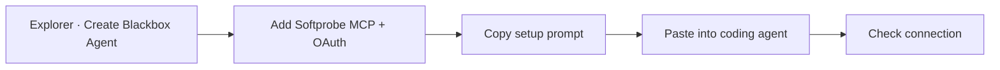

# Quick start

Create a Blackbox Agent in Softprobe Explorer, connect Softprobe MCP in your coding agent, paste the generated setup prompt, and verify your first captured Session.

## Flow

## 1. Create a Blackbox Agent

In Softprobe Explorer, open **Agents** and click **+ Connect agent**. Name the Agent, select the environment, and choose the app integration (**Traditional web app**, **LangChain**, **Vercel AI**, or **OpenCode**).

Softprobe mints an ingest-only Agent API key (`spk_...`). This key is valid only to ingest OTLP telemetry at `https://explorer.softprobe.ai/api/thelake/v1/traces`. It cannot read Sessions or manage Agents.

## 2. Add Softprobe MCP and sign in

Add `https://explorer.softprobe.ai/mcp` to Claude Code, Codex, Cursor, OpenCode, or Antigravity (`agy`) using the commands shown in Explorer, then complete the Explorer OAuth sign-in flow. Your coding agent uses this OAuth connection to call `list_workspaces`, `search_sessions`, and `get_session_spans`.

Full details: [Investigate with a coding agent](/en/agent-qa/coding-agent-skills).

## 3. Send the Blackbox setup prompt

Copy the generated Blackbox setup prompt from Explorer and paste it into your application repository in your coding agent. The prompt includes the Softprobe Blackbox architecture, your ingest-only Agent API key, the `@softprobe/web-record` browser SDK and official OpenTelemetry OBI v1.0.0 configuration templates, and framework instrumentation when an AI framework is selected.

| App integration | What the setup prompt configures |
|-----------------|----------------------------------|
| **Traditional web app** | `@softprobe/web-record` in the browser entrypoint and official OpenTelemetry OBI v1.0.0 (`obi.yaml`) on the backend |
| **LangChain** | Browser + OBI capture plus `softprobe[langchain]` (Python) or `@softprobe/langchain` (TypeScript) |
| **Vercel AI** | Browser + OBI capture plus `@softprobe/vercel-ai-sdk` and `@softprobe/tracing` |
| **OpenCode** | Browser + OBI capture plus `@softprobe/opencode-plugin` |

Full details: [Capture a web app session with HTTP bodies](/en/agent-qa/application-session-capture), [OpenCode install](/en/agent-qa/opencode), [LangChain install](/en/agent-qa/langchain).

## 4. Verify capture

Run a synthetic journey in your app, then ask your coding agent to verify the captured Session via Softprobe MCP or click **Check connection** in Explorer. Explorer checks that HTTP spans appear in **Graph** (and that generation and tool spans appear in **Trajectory** for AI framework apps).

## Next

- [Capture a web app session with HTTP bodies](/en/agent-qa/application-session-capture)
- [OpenCode install reference](/en/agent-qa/opencode)
- [LangChain install reference](/en/agent-qa/langchain)
- [Concepts](/en/agent-qa/concepts)
