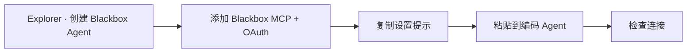

# 快速开始

在 Softprobe Explorer 中创建 Blackbox Agent，在编码 Agent 中连接 Blackbox MCP，粘贴生成的设置提示，并验证首个捕获的 Session。

## 流程

## 1. 创建 Blackbox Agent

在 Softprobe Explorer 打开 **Agents**，点击 **+ Connect agent**。命名 Agent、选择环境，并选择应用集成（**Traditional web app**、**LangChain**、**Vercel AI** 或 **OpenCode**）。Softprobe 会为该 Agent 签发仅用于上报的 API key（`spk_…`）。

## 2. 添加 Blackbox MCP 并登录

按照 Explorer 中显示的命令，在 Claude Code、Codex、Cursor 或 OpenCode 中将 `https://explorer.softprobe.ai/mcp` 添加为 `blackbox`，然后完成 Explorer OAuth 登录。

完整说明见：[用编码 Agent 排查](/zh/agent-qa/coding-agent-skills)、[OpenCode 安装](/zh/agent-qa/opencode)、[LangChain 安装](/zh/agent-qa/langchain)。

## 3. 发送 Blackbox 设置提示与验证捕获

在应用中运行一次合成旅程，然后让编码 Agent 通过 Blackbox MCP 验证捕获的 Session，或在 Explorer 点击 **Check connection**。

## 下一步

- [OpenCode 安装参考](/zh/agent-qa/opencode)
- [LangChain 安装参考](/zh/agent-qa/langchain)
- [概念](/zh/agent-qa/concepts)
